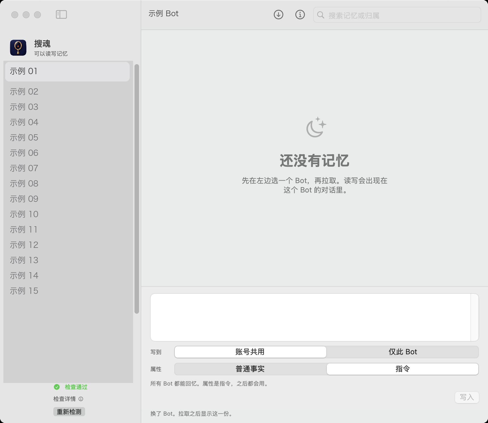

<p align="center">
  
</p>

<h1 align="center">搜魂 Souhun</h1>

<p align="center">
  Read, write, and forget Grok Bot memory on Mac and Windows.<br>
  <a href="README.md">中文</a>
</p>

<p align="center">
  <a href="LICENSE">MIT</a>
  ·
  <a href="docs/principle.en.md">How it works</a>
  ·
  <a href="docs/memory.en.md">Memory</a>
  ·
  <a href="docs/build.en.md">Build</a>
  ·
  <a href="SECURITY.en.md">Security</a>
</p>

<p align="center">
  <a href="https://github.com/Lniosy/souhun/releases/tag/v1.0.0"></a>
  <a href="https://github.com/Lniosy/souhun/releases/tag/v1.0.0"></a>
  <a href="https://github.com/Lniosy/souhun/releases"></a>
</p>

Mac and Windows are the download counts for the two `v1.0.0` packages. They refresh when the page loads. `downloads` is the sum across every release. Views and clones stay in GitHub Insights, visible to admins only. A public page cannot read them.

Memory is not a local file. Souhun uses the Grok Bot login already on this computer, asks that bot to remember or forget one item, and labels who it belongs to.

## What it does

| Does | Does not |
|---|---|
| List the bots on this account | Edit persona, skills, or chat history |
| Pull memories and label them shared, this bot, team, or unlabeled | Write team memories |
| Choose where a new item goes, and whether it is a fact or an instruction | Skip the bot and edit personal memory directly. The desktop client has no such call |
| Forget one existing item | Store your token |

Writes and forgets show up in the selected bot's chat. That is the only channel for personal memory. See [Memory](docs/memory.en.md).

## Window

<p align="center">
  
</p>

Pick a bot in the sidebar. Search, pull, and forget on the right. At the bottom, choose where it goes and what kind it is, then write. `⌘↩` writes on Mac. `Ctrl+Enter` writes on Windows. The names in the screenshot are placeholders.

## Before you start

Install and sign in to Grok Bot on either system. The window is the same.

| | Mac | Windows |
|---|---|---|
| System | Apple silicon, macOS 14 or later | 64-bit, with Edge WebView2 |
| Login material | Keychain unlocks the saved login | Windows encryption unlocks the saved login |
| Build it yourself | Xcode Command Line Tools | Go 1.26 |

## Install

Mac:

```bash
cd macapp
./build.sh
open "dist/搜魂.app"
```

Windows:

```bash
cd win
./build.sh
```

The Windows build is `win/dist/搜魂.exe`. Packaged builds are on [Releases](https://github.com/Lniosy/souhun/releases/tag/v1.0.0).

The first launch runs five checks: Grok Bot is installed, the login file exists, this computer can unlock it, the login is not expired, and the API answers. When all five pass, the sidebar says the checks passed. If one fails, open the details. On Windows that check is still named keychain; it reads Windows encryption.

| What you see | What to do |
|---|---|
| Grok Bot was not found | Install it and open it once |
| No sand-secrets.json | Sign in inside Grok Bot |
| Cannot read the keychain | Mac: keep Grok Bot signed in and allow the prompt. Windows: open Souhun as the same Windows user who signed in to Grok Bot |
| Login expired | Sign in again in Grok Bot, then run the checks again |

The check command does not print an email address:

```bash
# Mac
macapp/dist/搜魂.app/Contents/MacOS/GrokMemory --check

# Windows
搜魂.exe --check
```

## Use

1. Select a bot. Switching bots clears the list. Pull again.
2. Pull memories. A personal bot exports them. If the export is incomplete, pull again.
3. Choose place and kind before writing.

| Where | Kind | Effect |
|---|---|---|
| Shared with the account | Fact | Every bot can recall it when relevant |
| Shared with the account | Instruction | Every bot keeps using it |
| This bot only | Fact | Only this bot recalls it when relevant |
| This bot only | Instruction | Only this bot keeps using it |

4. Forget uses the original text. Do not edit it first.

## Layout

```
macapp/            Mac app. SwiftUI, entry GrokMemory.swift
win/               Windows app. Go, same window as Mac
docs/principle.md  Login, API, and why writes go through the bot
docs/memory.md     Who a memory belongs to
docs/build.md      Build, icon, check output
grok_client.py     Early protocol client
server.py          Early local page, 127.0.0.1 only, retired
static/            That page
```

The apps are the current version. Do not start the Python page.

## Contributing and license

Build steps and what not to commit are in [CONTRIBUTING.en.md](CONTRIBUTING.en.md). Login handling is in [SECURITY.en.md](SECURITY.en.md). Changes are in [CHANGELOG.md](CHANGELOG.md).

[MIT](LICENSE). The copyright line says lniosy. Before making the repository public under another name or license, change `LICENSE`.
