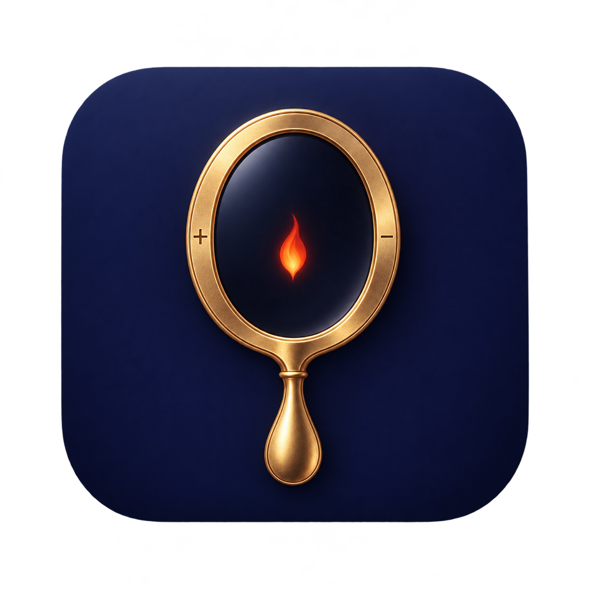
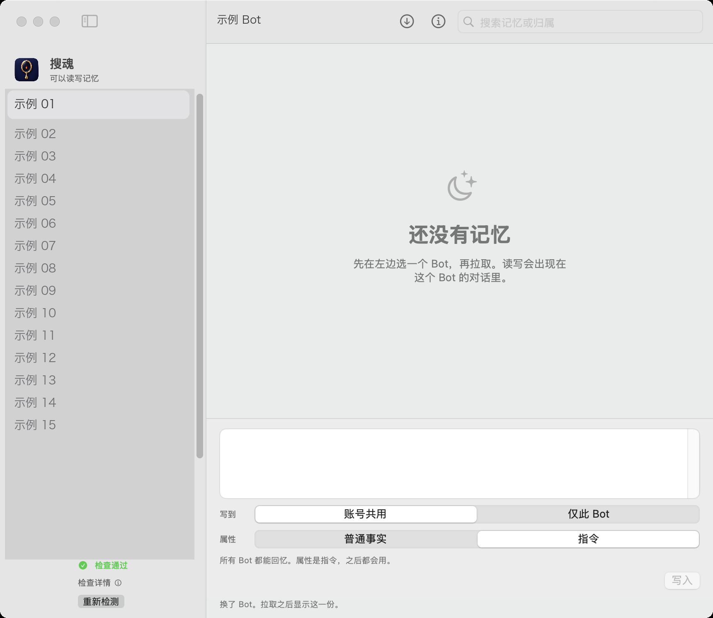

<p align="center">
  
</p>

<h1 align="center">搜魂</h1>

<p align="center">
  在 Mac 和 Windows 上查看、写入和忘掉 Grok Bot 的记忆。<br>
  <a href="README.en.md">English</a>
</p>

<p align="center">
  <a href="LICENSE">MIT</a>
  ·
  <a href="docs/principle.md">原理</a>
  ·
  <a href="docs/memory.md">记忆怎么分</a>
  ·
  <a href="docs/build.md">编译</a>
  ·
  <a href="SECURITY.md">安全</a>
</p>

<p align="center">
  <a href="https://github.com/Lniosy/souhun/releases/tag/v1.0.0"></a>
  <a href="https://github.com/Lniosy/souhun/releases/tag/v1.0.0"></a>
  <a href="https://github.com/Lniosy/souhun/releases"></a>
</p>

Mac、Windows 是当前 `v1.0.0` 两个安装包的下载次数，打开页面就会更新。`downloads` 是所有版本加在一起。仓库浏览和克隆在 GitHub 的 Insights 里，只对管理员可见，公开页面读不到。

记忆不在本机文件里。搜魂使用你已经登录的 Grok Bot，把一条记忆交给对应的 Bot 记住或忘掉，并在列表里标出它属于谁。

## 适合什么

| 能做 | 不做 |
|---|---|
| 列出本账号的 Bot | 不改人设、技能、聊天记录 |
| 拉取一份记忆，并标出账号共用、仅此 Bot、团队或未标明 | 不写入团队记忆 |
| 写入时选定位置和属性 | 不绕过 Bot 直接改个人记忆。桌面端没有这条接口 |
| 忘掉一条已有记忆 | 不保存你的令牌 |

写入和忘掉会出现在所选 Bot 的对话里。这是当前唯一的个人记忆通道。细节见 [记忆怎么放](docs/memory.md)。

## 窗口

<p align="center">
  
</p>

侧栏选 Bot。右边搜索、拉取、逐条忘掉。底部先选「写到」和「属性」，再写入。`⌘↩` 同样是写入。Windows 上是 `Ctrl+Enter`。

## 准备

两边都要先安装并登录 Grok Bot。界面相同。

| | Mac | Windows |
|---|---|---|
| 系统 | Apple 芯片，macOS 14 或更新 | 64 位，已安装 Edge WebView2 |
| 登录材料 | 钥匙串解开本机登录记录 | 系统加密解开本机登录记录 |
| 自己编译 | Xcode 命令行工具 | Go 1.26 |

## 安装

Mac：

```bash
cd macapp
./build.sh
open "dist/搜魂.app"
```

Windows：

```bash
cd win
./build.sh
```

产物是 `win/dist/搜魂.exe`。也可以从 [Releases](https://github.com/Lniosy/souhun/releases/tag/v1.0.0) 下载已经打好的包。

第一次打开会做五项检查：Grok Bot 是否安装、登录文件、本机能否解开登录、登录是否过期、接口是否连通。五项都通过之后，侧栏显示「检查通过」。某一项失败时，点「需要处理」看原因。Windows 上这项检查的名字仍叫钥匙串，实际读的是系统加密。

常见的下一步：

| 界面提示 | 处理 |
|---|---|
| 没找到 Grok Bot | 先安装，并至少打开一次 |
| 没有 sand-secrets.json | 在 Grok Bot 里登录 |
| 读不到钥匙串 | Mac：保持 Grok Bot 登录，系统询问时允许读取。Windows：用登录过 Grok Bot 的同一个 Windows 用户打开 |
| 登录已过期 | 回到 Grok Bot 重新登录，再点「重新检测」 |

自检命令不打印邮箱：

```bash
# Mac
macapp/dist/搜魂.app/Contents/MacOS/GrokMemory --check

# Windows
搜魂.exe --check
```

## 使用

1. 在左边选一个 Bot。换 Bot 之后，右边的列表会清空，需要再拉取。
2. 点「拉取记忆」。个人 Bot 由该 Bot 导出；导出不完整时，再拉一次。
3. 写一条时先选位置和属性。

| 写到 | 属性 | 效果 |
|---|---|---|
| 账号共用 | 普通事实 | 所有 Bot 在用到时回忆 |
| 账号共用 | 指令 | 所有 Bot 之后都会用 |
| 仅此 Bot | 普通事实 | 只有当前 Bot 在用到时回忆 |
| 仅此 Bot | 指令 | 只有当前 Bot 之后都会用 |

4. 点某条上的「忘掉」。忘掉按原文匹配，不要先改字。

## 仓库

```
macapp/            Mac 应用。SwiftUI，入口 GrokMemory.swift
win/               Windows 应用。Go，界面与 Mac 版一致
docs/principle.md  登录、接口，以及为什么读写要经过 Bot
docs/memory.md     记忆归属和属性
docs/build.md      编译、图标、自检输出
grok_client.py     早期协议客户端
server.py          早期本机网页，只监听 127.0.0.1，已停用
static/            上述网页的页面
```

图形界面是现在要用的版本。Python 网页不要再开。

## 参与和许可

构建步骤和不要提交的内容在 [CONTRIBUTING.md](CONTRIBUTING.md)。登录信息怎么处理在 [SECURITY.md](SECURITY.md)。版本变化在 [CHANGELOG.md](CHANGELOG.md)。

[MIT](LICENSE)。版权持有人写的是 lniosy。公开仓库之前，如果要用别的名字或别的许可证，改 `LICENSE` 这一处即可。
